# Editing the Sakalam Overland website

This guide is for the crew members who keep the website up to date. You don't need to know any code. Everything is done in a web page with normal forms, like filling out a Google Form.

**What you can change yourself:** events, trails (and their conditions), campsites, the rig showcase, merch, Trail Tagalog words, the home page photos, the FAQ, and a few numbers and photos in Site settings.

**How long until changes are live:** about 1–2 minutes after you press **Publish now**.

---

## 1. Log in

Go to **sakalam-overland.vercel.app/admin** and press **Login with GitHub**. A small window opens: sign in to GitHub (first time only, press **Authorize**) and it closes by itself.

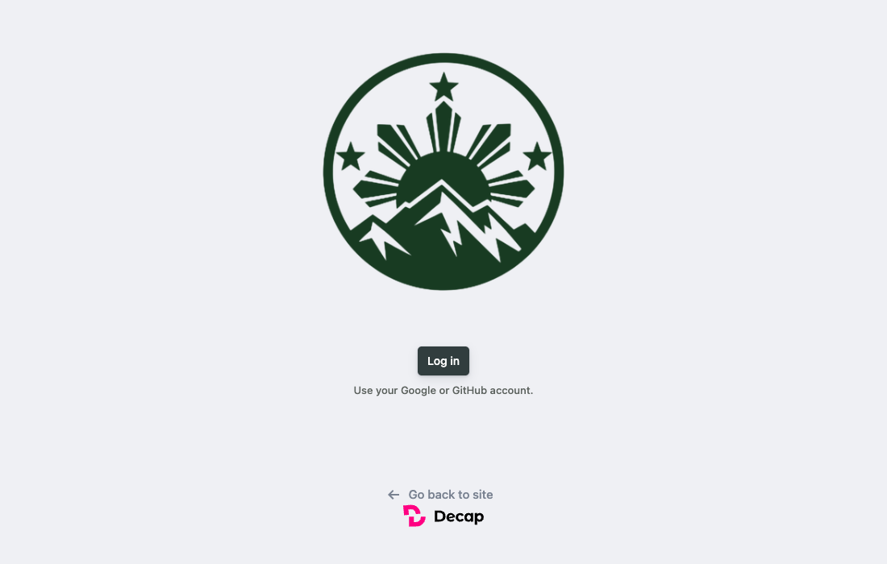

> First time? You need a free GitHub account, and the site manager has to add you to the project (you'll get an email from GitHub: press **Accept invitation**). Your GitHub email and password are your login for the editor.

---

## 2. Pick what to edit

After logging in you'll see every section of the site. Click the one you want.

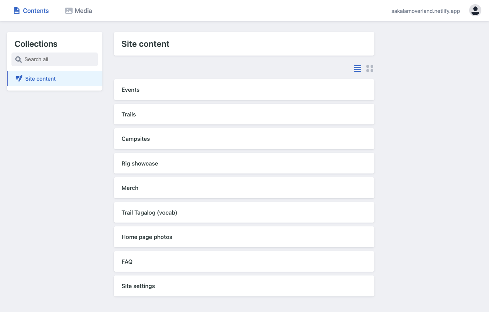

| Section | Where it shows on the site |
|---|---|
| **Events** | Home page calendar cards, the Events page, and each event's own page |
| **Trails** | The Trails page and the "Trail intel" list on the home page |
| **Campsites** | The Campsites page |
| **Rig showcase** | "Every rig gets a name" on the Community page |
| **Merch** | "Wear the sun" on the Community page |
| **Trail Tagalog (vocab)** | "Words you'll hear on the radio" on the Community page |
| **Home page photos** | The "From the trail" photo grid on the home page |
| **FAQ** | The questions next to the sign-up form on the Community page |
| **Site settings** | Instagram follower count, home page snapshot photo, Community page photos |

---

## 3. Edit, add or remove an item

Each section is a list. Click the **›** arrow on an item to open it.

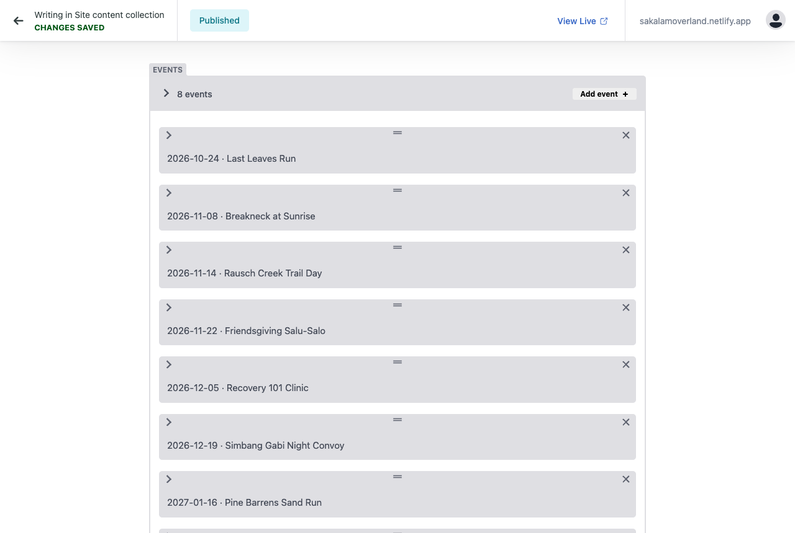

- **Edit:** open the item, change the text in the boxes.
- **Add:** press **Add event +** (or Add trail, Add rig, …) at the top. A blank form appears at the bottom of the list.
- **Remove:** press the **✕** on the right of the item.
- **Reorder:** drag the **═** handle in the middle of the item's bar. (Events sort themselves by date, so you don't need to reorder those.)

Every box has a short hint underneath telling you what to type.

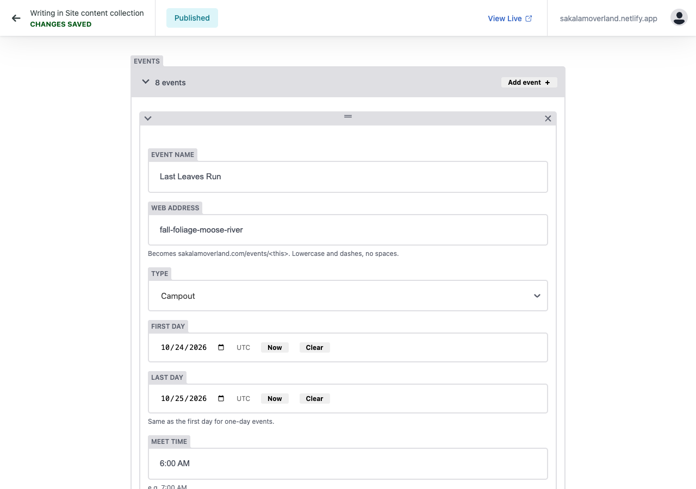

### Tips for events

- **Web address** is the end of the event's link, e.g. `winter-sand-run` becomes `…/events/winter-sand-run`. Use lowercase letters and dashes only, and don't change it after you've shared the link.
- **First day / Last day:** for a one-day event, set both to the same date.
- **Spots already taken:** the site adds online RSVPs on top of this number. Use it for people who signed up by text or in person.
- **Trail** and **Campsite** are optional drop-downs. Picking one links the event to that trail's page, including its elevation chart.
- **Past events disappear on their own** the day after they end. You don't have to delete them (but you can).

---

## 4. Update trail conditions

After someone scouts a trail, open it under **Trails** and update three things:

1. **Current status:** Open, Caution, Seasonal or Closed.
2. **Conditions note:** what you saw, in a sentence or two.
3. **Last checked:** press **Now** to set today's date.

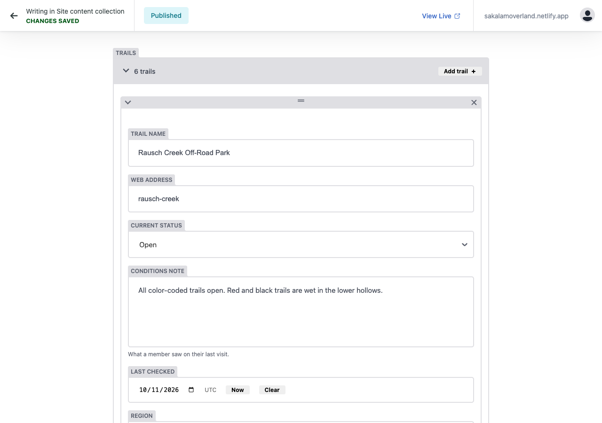

This is what visitors see:

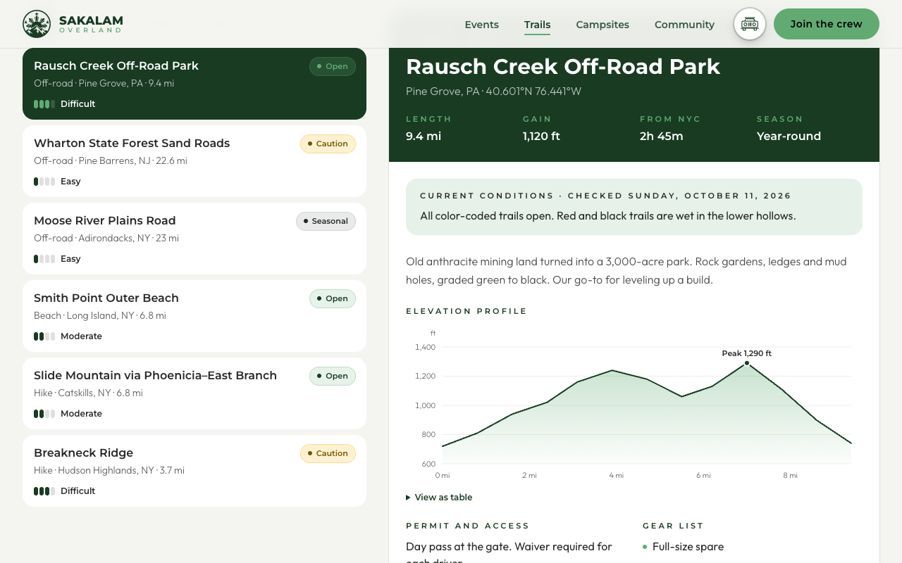

The **Elevation profile** at the bottom of the form is a list of points (mile and height in feet). You only need to fill it in for new trails. Most GPS apps (Gaia, AllTrails, onX) can show these numbers.

---

## 5. Add photos

Anywhere you see **Choose an image** you can add a photo. If you leave it empty, the site shows one of its drawn mountain pictures instead, so it never looks broken.

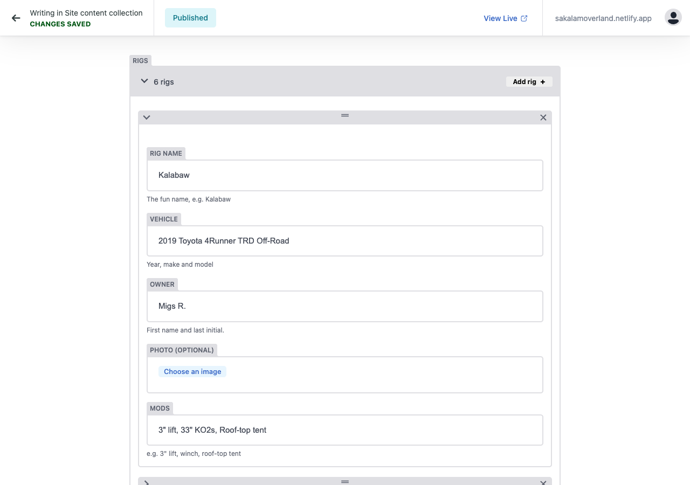

1. Press **Choose an image**.
2. Press **Upload** and pick a photo from your phone or computer.
3. Make sure it's selected (blue outline), then press **Choose selected**.

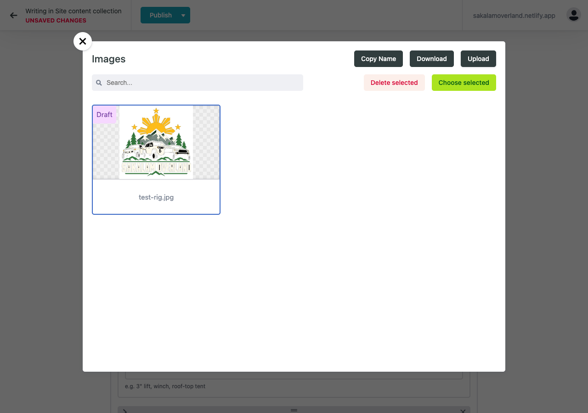

**Photo tips**

- Use JPG photos under about **2 MB**. Phone photos are fine; if a photo is huge, send it to yourself on Messenger or email first to shrink it.
- Wide (landscape) photos work best for campsites and the home grid; square photos for merch and the home snapshot.
- Only post photos of people who are OK with being on the site.
- Rename the file to something readable before uploading (e.g. `kalabaw-4runner.jpg` instead of `IMG_4821.jpg`). It makes the library easier to search later.

Rig photos show up like this:

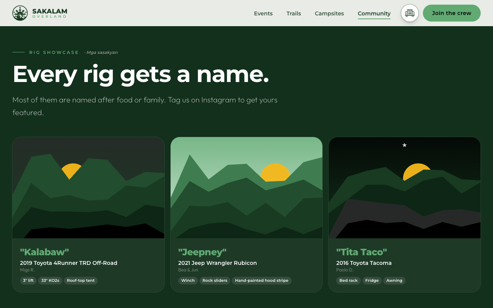

---

## 6. Site settings

Small things that change now and then: the Instagram follower number on the home page, the "states we ride" number, the tilted snapshot photo next to the tire (and its caption), and the three photos at the top of the Community page.

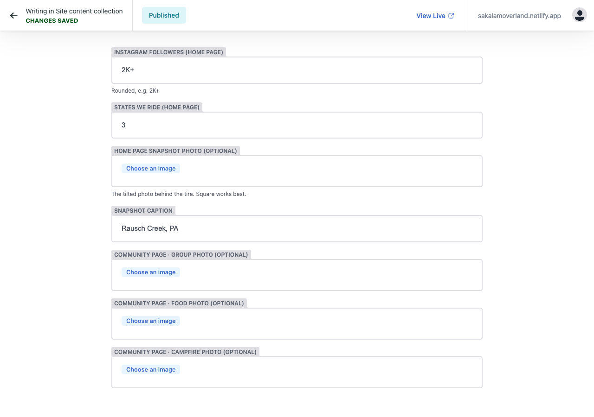

---

## 7. Publish

Nothing goes live until you publish. When you have unsaved changes, the top bar turns red ("UNSAVED CHANGES") and the **Publish** button appears.

Press **Publish**, then **Publish now**.

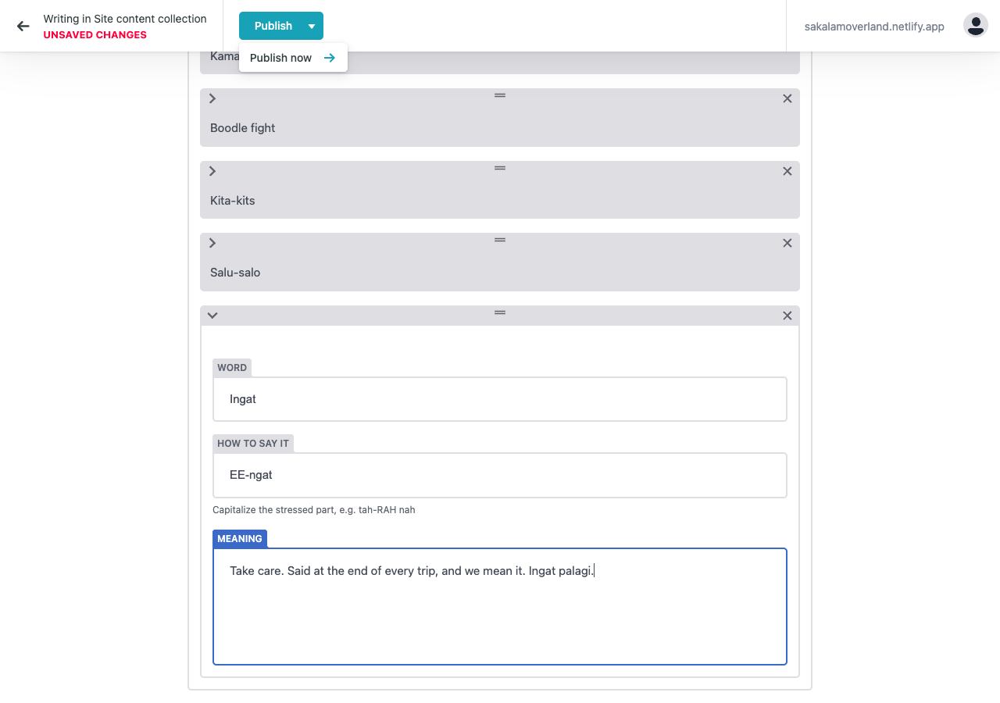

The bar turns green ("CHANGES SAVED"). Give it **1–2 minutes**, then refresh the website to see your change. Here's the home page calendar after events are published:

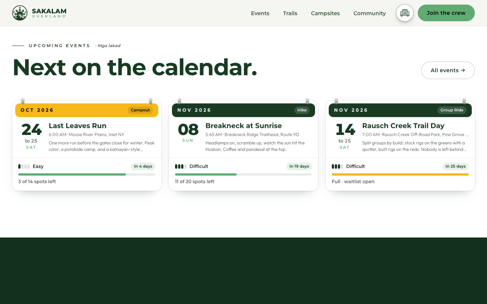

---

## If something goes wrong

| Problem | What to do |
|---|---|
| "Login" does nothing / I can't log in | Allow pop-ups for the site, then try again. Make sure you accepted the GitHub invitation email. Forgot your password? Reset it at github.com. |
| I published but the site didn't change | Wait 2 minutes, then refresh. On a phone, close the tab and reopen it. |
| I made a mistake and published it | Fix it and publish again. Every version is saved, so the site manager can also restore an older one if needed. |
| A red message says a box is required or invalid | Read the hint under that box (e.g. Web address must be lowercase with dashes). The form won't publish until it's fixed. |
| Someone else edited at the same time | Refresh the editor before you start, and avoid editing the same section at the same time. |
| A photo won't upload | It's probably too big. Shrink it (see Photo tips) and try again. |

---

## For whoever manages the website (one-time setup)

The site is on Vercel, and owners sign in with GitHub. You only do this once.

1. **Create a GitHub OAuth app:** GitHub → your profile picture → **Settings → Developer settings → OAuth Apps → New OAuth App**.
   - Application name: `Sakalam Overland CMS`
   - Homepage URL: `https://sakalam-overland.vercel.app`
   - Authorization callback URL: `https://sakalam-overland.vercel.app/api/callback`
   - Press **Register application**, then **Generate a new client secret**. Keep the page open.
2. **Give Vercel the keys:** Vercel → the `sakalam-overland` project → **Settings → Environment Variables**. Add:
   - `GITHUB_CLIENT_ID` = the Client ID from step 1
   - `GITHUB_CLIENT_SECRET` = the client secret from step 1
3. **Redeploy:** Vercel → **Deployments** → the latest one → **⋯ → Redeploy** (new variables only apply to new deployments).
4. **Add each owner:** GitHub → the `Sakalam-Overland` repo → **Settings → Collaborators → Add people** → their GitHub username or email. They get an email and press **Accept invitation**. Anyone you add can edit the site; remove them here to take access away.

If the site moves to a new address, update the callback URL in the GitHub OAuth app and `base_url`, `site_url` and `display_url` in `client/public/admin/config.yml`.

**Editing on your own computer (no login needed):** run `npm run dev` and, in a second terminal, `npm run cms`, then open http://localhost:5173/admin. Changes save straight into the `content/` folder; commit them like any other change.

**Where things live:**

- Text content: `content/*.json` (one file per section)
- Uploaded photos: `client/public/photos/`
- Editor setup (fields, hints, labels): `client/public/admin/config.yml`
- The API (`server/`) reads the same files. If you run it with MongoDB, run `npm run seed` after content changes so the database matches.
